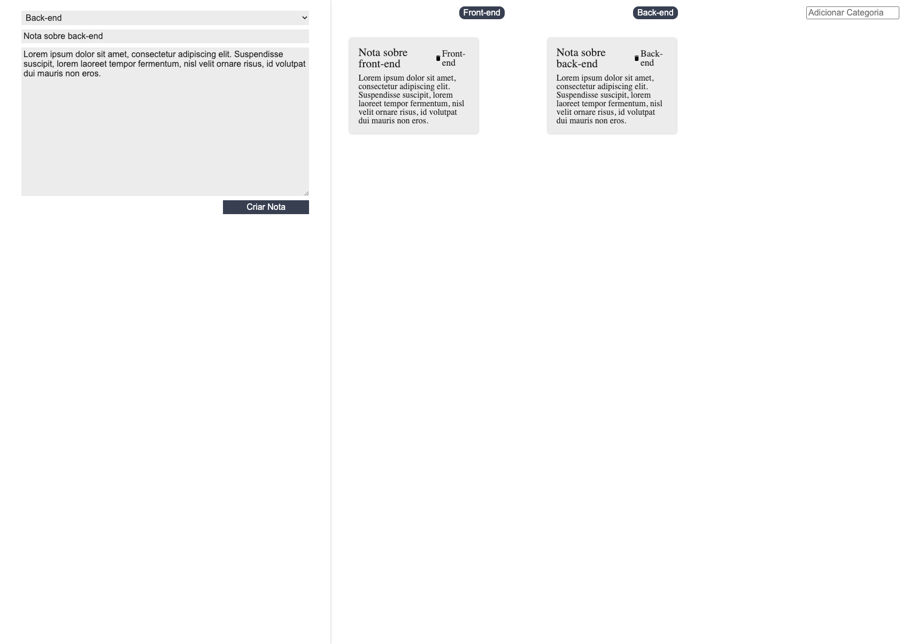
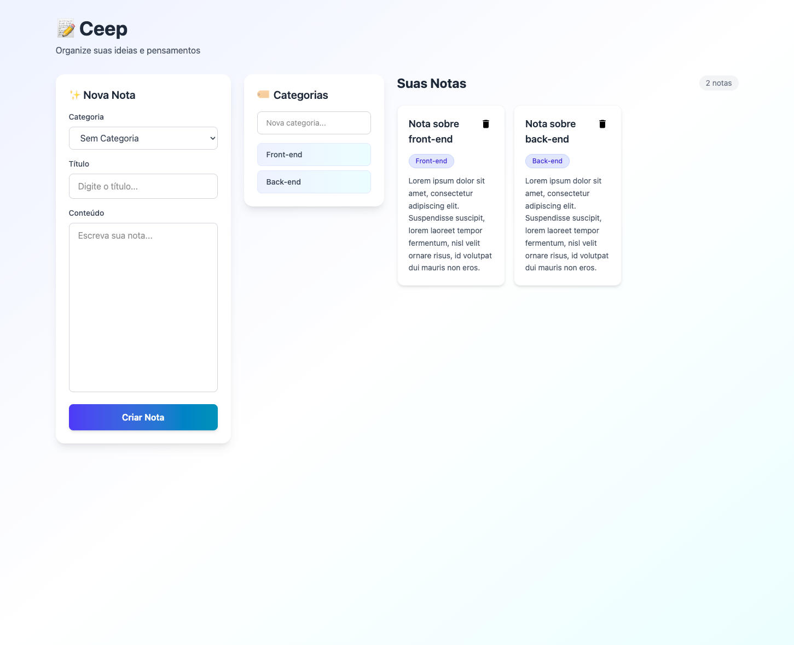

# Desafio: Migração de Código Legado para React Moderno

> Do passado para o futuro: transforme um projeto React 16 em uma aplicação moderna com React 19, Vite e Tailwind CSS!

## Créditos

Este projeto foi originalmente desenvolvido no curso **[React: entendendo como a biblioteca funciona](https://cursos.alura.com.br/course/react-entendendo-biblioteca-funciona)** da Alura, criado há 5 anos atrás (2020). 

O código que você vê aqui é uma **cápsula do tempo**: representa as melhores práticas e tecnologias de React da época. Agora, sua missão é trazê-lo para 2025! 🚀

## O Projeto

Este é um aplicativo de notas (similar ao Google Keep) escrito em **React 16.13.1** (lançado em 2020), usando **Create React App** e padrões que já não são mais recomendados.

**Funcionalidades:**
- Criar notas com título e texto
- Organizar notas por categorias
- Adicionar novas categorias
- Excluir notas

**A situação:** O código funciona perfeitamente, mas está completamente desatualizado. Sua missão? Modernizá-lo!

## Antes e Depois

<div align="center">

### Versão Legado (React 16 + CRA)


### Versão Modernizada (React 19 + Vite + Tailwind)


</div>

---

## Como Executar o Projeto Legado

### Requisitos de Versão do Node.js

**IMPORTANTE:** Este projeto legado usa `react-scripts 3.4.1`, que **só funciona com Node.js 16 ou inferior**.

Se você estiver usando Node.js 17 ou superior, o projeto **não vai funcionar** e você verá erros como:
```
Error: error:0308010C:digital envelope routines::unsupported
```

### Instalando e Usando o NVM (Node Version Manager)

O NVM permite que você tenha múltiplas versões do Node.js instaladas e alterne entre elas facilmente.

#### Windows

**1. Instale o NVM para Windows:**
- Baixe o instalador: [nvm-windows releases](https://github.com/coreybutler/nvm-windows/releases)
- Execute o arquivo `nvm-setup.exe`
- Siga o assistente de instalação

**2. Verifique a instalação:**
```bash
nvm version
```

**3. Instale o Node 16:**
```bash
nvm install 16
```

**4. Use o Node 16:**
```bash
nvm use 16
```

**5. Verifique se está usando a versão correta:**
```bash
node -v
# Deve mostrar: v16.x.x
```

#### Quer saber mais sobre NVM?

Recomendo **fortemente** que você leia este artigo completo da Alura:
- [Node.JS: Descomplicando o trabalho com diferentes versões](https://www.alura.com.br/artigos/descomplicando-o-trabalho-com-node)

O artigo explica:
- Por que o NVM é útil no dia a dia
- Como instalar em diferentes sistemas operacionais
- Comandos avançados
- Quando usar Docker vs NVM

### Executando o Projeto

Depois de configurar o Node 16:

```bash
# Instalar dependências
npm install

# Iniciar o servidor de desenvolvimento
npm start
```

O projeto abrirá em `http://localhost:3000`

---

## Seu Desafio

**Migrar este projeto de React 16 para React 19**, modernizando completamente sua arquitetura e interface.

**Importante:** O objetivo **NÃO é refazer o projeto do zero**, mas sim **evoluir o código existente de forma incremental e segura**, mantendo todas as funcionalidades originais.

Isso simula uma situação **100% real de mercado**: você entra em um time e precisa dar continuidade a um sistema já existente, entendendo decisões antigas e implementando melhorias sem quebrar nada.

## O que Está Desatualizado?

Antes de começar, veja tudo que precisa ser modernizado:

| Item | Versão Antiga | Versão Alvo | Impacto |
|------|---------------|-------------|---------|
| **React** | 16.13.1 (2020) | 19.2.0 (2024) | APIs descontinuadas, novos recursos |
| **Bundler** | Create React App | Vite | Build 10-100x mais rápido |
| **Componentes** | Class Components | Function Components + Hooks | Padrão moderno |
| **Estilização** | CSS Modules | Tailwind CSS | Utility-first, responsivo |
| **State Management** | Observer Pattern legado | Context API | Padrão React nativo |

### Problemas do Código Legado

**1. Class Components** (padrão de 2015)
```javascript
class App extends Component {
  constructor() {
    super();
    // state management complicado
  }
  
  render() {
    return <div>...</div>
  }
}
```

**2. Lifecycle Methods** (substituídos por hooks)
```javascript
componentDidMount() { }
componentWillUnmount() { }
```

**3. Uso extensivo de `bind()`** (verbose e confuso)
```javascript
<button onClick={this._criarNota.bind(this)}>
```

**4. Observer Pattern customizado** (quando poderia usar Context API)

**5. Create React App** (lento e defasado)

**6. CSS tradicional** (não escalável)

---

## Caminho Sugerido de Migração

Existem várias formas de modernizar este projeto, mas recomendo seguir este caminho incremental e seguro:

### Etapa 1: Bump das Bibliotecas (React 16 → 19)

**O que fazer:**
- Atualizar React, ReactDOM e react-scripts
- Migrar `ReactDOM.render()` para `ReactDOM.createRoot()`
- Converter todos os class components para function components
- Implementar hooks (`useState`, `useEffect`, `useCallback`)
- Substituir observer pattern por Context API

**Por que nessa ordem:**
- Garante que o app continue funcionando após cada mudança
- Permite testar incrementalmente
- Aprende os conceitos do React moderno antes de partir para outras ferramentas

**Commits sugeridos:**
1. "Atualiza React 16 → 19 e dependências"
2. "Migra ReactDOM.render para createRoot"
3. "Converte [NomeComponente] para function component"
4. "Implementa Context API para gerenciamento de estado"

### Etapa 2: Migração para Vite

**O que fazer:**
- Remover Create React App (react-scripts)
- Instalar e configurar Vite
- Criar `vite.config.js`
- Mover `index.html` para a raiz
- Renomear arquivos `.js` com JSX para `.jsx`
- Atualizar importações de SVG

**Por que migrar para Vite:**
- **Build 10-100x mais rápido** que CRA
- **Hot Module Replacement instantâneo**
- **Bundle 90% menor** (147 vs 1567 pacotes)
- **Zero configuração** para React
- **Padrão da indústria** em 2024

**Commits sugeridos:**
1. "Remove CRA e configura Vite"
2. "Ajusta estrutura de arquivos para Vite"
3. "Corrige importações e paths"

### Etapa 3: Modernização Visual com Tailwind CSS

**O que fazer:**
- Instalar Tailwind CSS e plugin Vite
- Remover todo CSS customizado
- Redesenhar interface com Tailwind
- Implementar design system moderno
- Tornar totalmente responsivo

**Por que Tailwind:**
- **Utility-first:** Escreve CSS diretamente no JSX
- **Design consistente:** Sistema de cores, espaçamentos e tipografia
- **Responsividade fácil:** Classes como `md:`, `lg:`
- **Customizável:** Adapta-se ao seu design system
- **Produtividade:** Desenvolvimento muito mais rápido

**Commits sugeridos:**
1. "Adiciona Tailwind CSS ao projeto"
2. "Moderniza interface do [Componente]"
3. "Implementa design system com Tailwind"

---

## Guia Passo a Passo

### Fase 1: Preparação

- [ ] **Clone o repositório e crie uma branch**
  ```bash
  git checkout -b migracao-react-19
  ```

- [ ] **Configure Node 16 e teste o projeto legado**
  ```bash
  nvm use 16
  npm install
  npm start
  ```

- [ ] **Explore o código:**
  - Teste todas as funcionalidades
  - Entenda a estrutura de pastas
  - Leia os componentes principais
  - Identifique padrões e anti-padrões

### Fase 2: Atualização do React

- [ ] **Atualize as dependências no `package.json`**
  
  ```json
  "dependencies": {
    "react": "^19.2.0",
    "react-dom": "^19.2.0",
    "react-scripts": "^5.0.1"
  }
  ```

- [ ] **Reinstale as dependências**
  ```bash
  rm -rf node_modules package-lock.json
  npm install
  ```

- [ ] **Migre para a nova API de inicialização**
  
  Atualize `src/index.js`:
  ```javascript
  import ReactDOM from 'react-dom/client';
  
  const root = ReactDOM.createRoot(document.getElementById('root'));
  root.render(
    <React.StrictMode>
      <App />
    </React.StrictMode>
  );
  ```

- [ ] **Teste se o app carrega** (mesmo com class components)

### Fase 3: Conversão para Function Components

Esta é a parte mais trabalhosa! Converta cada componente seguindo este padrão:

**Antes (Class):**
```javascript
class MeuComponente extends Component {
  constructor(props) {
    super(props);
    this.state = { contador: 0 };
  }
  
  componentDidMount() {
    console.log('Montou!');
  }
  
  incrementar() {
    this.setState({ contador: this.state.contador + 1 });
  }
  
  render() {
    return (
      <button onClick={this.incrementar.bind(this)}>
        {this.state.contador}
      </button>
    );
  }
}
```

**Depois (Function + Hooks):**
```javascript
function MeuComponente(props) {
  const [contador, setContador] = useState(0);
  
  useEffect(() => {
    console.log('Montou!');
  }, []);
  
  function incrementar() {
    setContador(contador + 1);
  }
  
  return (
    <button onClick={incrementar}>
      {contador}
    </button>
  );
}
```

**Ordem recomendada:**
1. CardNota (mais simples)
2. ListaDeCategorias
3. ListaDeNotas
4. FormularioCadastro (mais complexo)
5. App (último)

**Dica importante:** O código usa um **Observer Pattern customizado** (`inscrever/desinscrever`). Você tem duas opções:

a) Manter o observer e usar `useCallback`:
```javascript
const callback = useCallback((dados) => {
  setDados(dados);
}, []);

useEffect(() => {
  props.model.inscrever(callback);
  return () => props.model.desinscrever(callback);
}, [props.model, callback]);
```

b) **Melhor opção:** Refatorar para Context API (mais React-way!):
```javascript
// NotasContext.jsx
export function NotasProvider({ children }) {
  const [notas, setNotas] = useState([]);
  
  function adicionarNota(titulo, texto, categoria) {
    setNotas([...notas, { titulo, texto, categoria }]);
  }
  
  return (
    <NotasContext.Provider value={{ notas, adicionarNota }}>
      {children}
    </NotasContext.Provider>
  );
}

// Nos componentes
const { notas, adicionarNota } = useNotas();
```

### Fase 4: Migração para Vite

- [ ] **Atualize `package.json`**
  ```json
  {
    "type": "module",
    "dependencies": {
      "react": "^19.2.0",
      "react-dom": "^19.2.0"
    },
    "devDependencies": {
      "@vitejs/plugin-react": "^4.3.4",
      "vite": "^6.0.3",
      "vite-plugin-svgr": "^4.3.0"
    },
    "scripts": {
      "dev": "vite",
      "build": "vite build",
      "preview": "vite preview"
    }
  }
  ```

- [ ] **Crie `vite.config.js` na raiz**
  ```javascript
  import { defineConfig } from 'vite'
  import react from '@vitejs/plugin-react'
  import svgr from 'vite-plugin-svgr'

  export default defineConfig({
    plugins: [
      react(),
      svgr()
    ],
    server: {
      port: 3000,
      open: true
    }
  })
  ```

- [ ] **Mova `public/index.html` para a raiz e ajuste**
  ```html
  <!DOCTYPE html>
  <html lang="pt-BR">
    <head>
      <meta charset="UTF-8" />
      <link rel="icon" href="/favicon.ico" />
      <meta name="viewport" content="width=device-width, initial-scale=1.0" />
      <title>Ceep - Notas</title>
    </head>
    <body>
      <div id="root"></div>
      <script type="module" src="/src/index.jsx"></script>
    </body>
  </html>
  ```

- [ ] **Renomeie arquivos com JSX**
  ```bash
  mv src/index.js src/index.jsx
  mv src/App.js src/App.jsx
  # ... outros arquivos com JSX
  ```

- [ ] **Atualize importações de SVG**
  ```javascript
  // Antes
  import { ReactComponent as Icon } from './icon.svg'
  
  // Depois
  import Icon from './icon.svg?react'
  ```

- [ ] **Reinstale e teste**
  ```bash
  rm -rf node_modules package-lock.json
  npm install
  npm run dev
  ```

### Fase 5: Tailwind CSS e Redesign

- [ ] **Instale Tailwind**
  ```bash
  npm install tailwindcss @tailwindcss/vite
  ```

- [ ] **Configure no `vite.config.js`**
  ```javascript
  import tailwindcss from '@tailwindcss/vite'
  
  export default defineConfig({
    plugins: [
      tailwindcss(),  // Adicione aqui
      react(),
      svgr()
    ]
  })
  ```

- [ ] **Importe no CSS principal**
  ```css
  /* src/assets/index.css */
  @import "tailwindcss";
  ```

- [ ] **Remova todo CSS antigo** e comece o redesign!

**Exemplo de modernização:**

Antes (CSS tradicional):
```jsx
<div className="card-nota">
  <h3 className="card-nota_titulo">{titulo}</h3>
  <p className="card-nota_texto">{texto}</p>
</div>
```

Depois (Tailwind):
```jsx
<div className="bg-white rounded-xl shadow-md hover:shadow-xl transition-all p-5 border border-gray-100">
  <h3 className="text-lg font-semibold text-gray-800 mb-3">
    {titulo}
  </h3>
  <p className="text-gray-600 text-sm leading-relaxed">
    {texto}
  </p>
</div>
```

**Design System Sugerido:**
- Cores: Indigo + Cyan (gradientes)
- Background: Gradiente suave
- Cards: Brancos com sombras
- Bordas: Arredondadas (rounded-xl, rounded-2xl)
- Transições: Suaves em hover
- Layout: Grid responsivo

---

## Dicas de Ouro

### Para Iniciantes

1. **Vá devagar!** 🐌
   - Migre **um componente por vez**
   - Teste após cada mudança
   - Commit frequentemente

2. **Entenda antes de mudar** 📚
   - Leia o código com atenção
   - Desenhe o fluxo de dados
   - Anote dúvidas

3. **Use o console do navegador** 🔍
   - Warnings te guiam
   - Errors te ensinam
   - React DevTools são seus amigos

4. **Google é seu aliado** 🔎
   - "Como converter class component para function component"
   - "useEffect vs componentDidMount"
   - "React Context API tutorial"

### Armadilhas Comuns

**Observer Pattern com useEffect:**
```javascript
// ❌ ERRADO - callback recriado a cada render
useEffect(() => {
  function callback(dados) {
    setDados(dados);
  }
  props.model.inscrever(callback);
  return () => props.model.desinscrever(callback); // callback diferente!
}, []);

// ✅ CERTO - callback estável
const callback = useCallback((dados) => {
  setDados(dados);
}, []);

useEffect(() => {
  props.model.inscrever(callback);
  return () => props.model.desinscrever(callback);
}, [props.model, callback]);
```

**State vs Refs:**
```javascript
// ❌ State para valores de input (causa re-renders desnecessários)
const [titulo, setTitulo] = useState('');
<input value={titulo} onChange={e => setTitulo(e.target.value)} />

// ✅ Refs para valores de form
const tituloRef = useRef(null);
<input ref={tituloRef} />
// Acessa com: tituloRef.current.value
```

**Cleanup de Effects:**
```javascript
// ❌ Esqueceu o cleanup
useEffect(() => {
  props.model.inscrever(callback);
}, []);

// ✅ Sempre faça cleanup
useEffect(() => {
  props.model.inscrever(callback);
  return () => props.model.desinscrever(callback);
}, []);
```

---

## Recursos de Estudo

### Documentação Oficial
- [React 19 Documentation](https://react.dev/)
- [Vite Guide](https://vitejs.dev/guide/)
- [Tailwind CSS Docs](https://tailwindcss.com/docs)

### Artigos Recomendados
- [Descomplicando o trabalho com Node.JS](https://www.alura.com.br/artigos/descomplicando-o-trabalho-com-node)

### Ferramentas Úteis
- **React DevTools:** Extensão do navegador para debug
- **Vite DevTools:** Análise de bundle
- **Tailwind IntelliSense:** Autocomplete no VSCode

---

## O Que Você Vai Aprender

Ao completar este desafio, você terá experiência prática em:

- ✅ **Trabalhar com código legado** (situação real de mercado)
- ✅ **Migrar entre versões do React** (16 → 19)
- ✅ **Converter class para function components**
- ✅ **Dominar React Hooks** (useState, useEffect, useCallback, useContext)
- ✅ **Implementar Context API** (gerenciamento de estado)
- ✅ **Configurar build tools modernos** (Vite)
- ✅ **Aplicar Tailwind CSS** (design system utility-first)
- ✅ **Fazer migrações incrementais** sem quebrar funcionalidades
- ✅ **Debugar problemas complexos**
- ✅ **Tomar decisões arquiteturais**

---

## Problemas Comuns e Soluções

### "O app não inicia após atualizar as dependências"
```bash
# Solução: Limpe tudo e reinstale
rm -rf node_modules package-lock.json
npm install
npm start
```

### "Erro: ReactDOM.render is no longer supported"
Você esqueceu de atualizar `src/index.js` para usar `createRoot`. Veja a **Fase 2**.

### "As notas/categorias não aparecem após migração"
Provavelmente erro no observer pattern. Considere migrar para Context API.

### "Warning: Cannot update a component while rendering"
Você está chamando `setState` diretamente no corpo do componente. Mova para `useEffect` ou event handler.

### "Build muito lento no Vite"
Você ainda está importando CSS do CRA? Remova todos os `import './estilo.css'` depois de migrar para Tailwind.

### "Node version error"
O projeto legado precisa de Node 16. Use `nvm use 16`.

---

## Compartilhe seu Progresso!

Não existe uma resposta única para esse desafio! Cada pessoa pode adotar estratégias diferentes, e é isso que torna este exercício tão rico.

**Mostre seu trabalho:**
- Poste prints do antes/depois no LinkedIn
- Escreva um artigo sobre seus aprendizados
- Faça um vídeo mostrando o processo
- Compartilhe no Discord da Alura

**Conte para a comunidade:**
- Quais foram os maiores desafios?
- Quanto tempo levou?
- O que você aprendeu que não esperava?
- Que decisões arquiteturais você tomou?
- Dicas para quem vai fazer depois?

Compartilhe sua experiência no **Discord da Alura** ou no **fórum do curso**. Essa troca fortalece o aprendizado coletivo!

---

## Conclusão

Este é um desafio real que simula o dia a dia de um desenvolvedor React. Não se preocupe se parecer difícil no começo - é assim mesmo! O importante é persistir, pesquisar e aprender com os erros.

**Lembre-se:**
- O foco não é refazer tudo do zero
- Mas sim evoluir o código existente
- Respeitando o que já foi construído
- Simulando uma situação real de trabalho

**Agora é com você!**

Boa sorte na migração e divirta-se aprendendo!

---

<div align="center">

**Feito com carinho para a comunidade Alura**

[Compartilhe seu progresso](https://www.alura.com.br/artigos/como-participar-comunidade-alura-discord) • [Veja o gabarito](https://github.com/viniciosneves/desafio-legado/tree/migracao-react-19) • [Tire dúvidas no fórum](https://cursos.alura.com.br/forum/todos/1)

</div>
